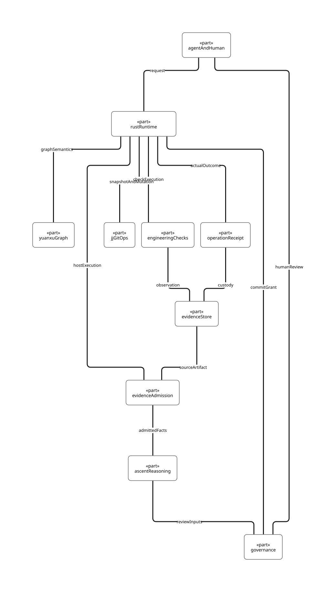
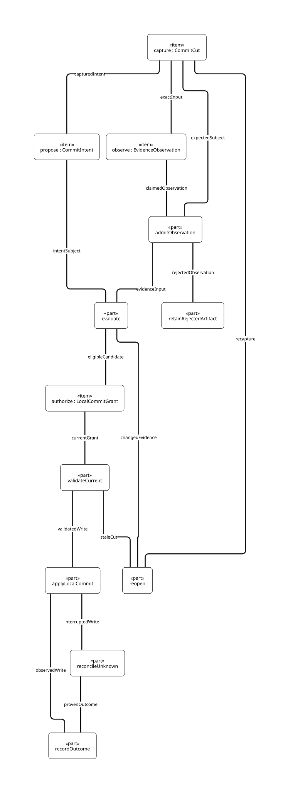
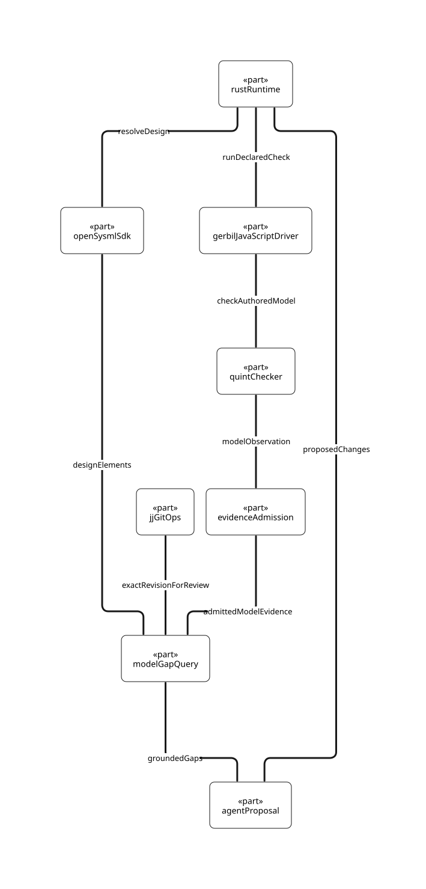

# SPDX-FileCopyrightText: 2026 tao3k team and Contributors
#
# SPDX-License-Identifier: Apache-2.0 AND LGPL-2.1-or-later

#+title: AITIA Rust SDLC and evidence-driven commit

The [[file:aitia-commit.sysml][SysML v2 model]] separates the 
from the . It is a design
for local commit finalization. The current Rust implementation can call the
Scheme SDLC Graph and GitOps evaluation. Rust can also observe a recorded JJ
workspace cut through =aitia jj-observe=. The GitOps Scope publishes ORG
observation matching and an ASCENT evidence query. Production execution
custody, Governance grants, guarded JJ mutation and operation recovery
in these views are design obligations.

The [[file:gitops-lifecycle.org][GitOps lifecycle and FFI boundary]] defines the target operation
contract between the Scheme Module and the Rust JJ adapter.

* Executable Assurance research scope

This design extends the existing Assurance Module. These references assign
each research question to its architecture owner and verification boundary.

| Research question | Design owner and evidence target |
|-------------------+----------------------------------|
| What does admitted evidence support? | [[file:../../docs/rfcs/0001-causal-assurance-core.org::*Support assessment][RFC 0001]] defines support, conditional closure, residuals and independent authorization. |
| How do assumptions and defeaters change? | RFC 0001 records scoped dispositions and the affected obligations. The current Host's conservative gate is the comparison control. |
| Which fragment did the method observe? | RFC 0001 binds strength, coverage and shared dependencies. [[file:../../docs/rfcs/0006-engineering-runtime-and-library-boundaries.org::*Execution and support assessment][RFC 0006]] binds the method to the input actually consumed. |
| Where do applicable objectives come from? | [[file:../../docs/rfcs/nasa-ai-assurance-objectives.org][NASA objective design]] separates standards lineage, project applicability and demonstrated support. |
| Where can the judgment be falsified? | The SysML AssuranceSupport package and RFC 0001 pair the ADR 0008 bounded replay with Agent input projection faults. |
| How does support age across revisions? | [[file:gitops-lifecycle.org::*Evidence validity experiments][GitOps evidence validity experiments]] bind the exact tested subject and compare scoped invalidation against the full snapshot gate. |

The local SysML checks qualify the structure of the architecture. The
bounded behavioral results are recorded separately in
[[file:../../docs/rfcs/0001-causal-assurance-core.org::*Agent input delivery boundary][RFC 0001]]
and the [[file:../qualification/job-executor/README.org::*Linked runtime replay assessment][ADR 0008 qualification]].
The linked runs check the exact Agent input sent to the consumer, the
fixed and buggy Worker outcomes, and reopening after the recorded source
changes. [[file:../../docs/rfcs/0006-engineering-runtime-and-library-boundaries.org::*Durable dispatch and acknowledgement][RFC 0006]]
records local Cedar delivery and fresh-process recovery, including the
remaining deployed Provider qualification.

* Rust workspace boundaries

| Crate | Responsibility in this slice |
|-------+------------------------------|
| =aitia-runtime= | Runs the Yuanxu SDLC Graph through the Scheme bridge. The proposed writer and recovery protocol belong at this execution boundary. |
| =aitia-jj= | Owns the JJ/GitOps adapter and repository observations. The current adapter is read-only. |
| =aitia-python= | Exposes Rust through PyO3 and Maturin. Python projects can supply their own engineering checks regardless of whether they use these bindings. |

The SDLC Graph selects checks appropriate to the user project. A Rust
project can supply a Cargo check and a Python project can supply a pytest
check. Both attach observations to the same kind of JJ cut. Engineering
libraries such as DE can supply checks under the same contract.

* Local commit contract

1. Rust captures one repository and workspace cut through the JJ adapter.
   Record the full change ID for lineage and the exact commit, tree, parents
   and operation ID for verification. Separate explicit working-copy snapshot
   from observation of a captured revision. Even seemingly observational JJ
   commands may snapshot working-copy changes by default.
2. Agents can propose descriptions, claims, checks and competing changes.
   A selected check receives the captured input and emits an observation.
   ORG Contract validates the declared structure. The admission boundary
   compares its subject and producer with independently obtained host data
   for the execution. A rejected artifact remains available for audit.
   ASCENT can
   derive competing support, contradiction, stale and eligibility relations
   over those admitted facts.
3. Governance grants the exact local write over the admitted intent and cut.
   Rust revalidates the cut at the writer boundary and consumes the grant.
   A new workspace operation or rewritten revision reopens affected
   obligations. Reused evidence retains its original source subject.
4. Record the actual before and after JJ operations, resulting revision and
   receipt. After an interrupted write, reconcile against the operation log
   and current repository state before considering any retry. Local commit
   finalization carries no bookmark publication or push authority.

The working copy is already represented as a commit in JJ. The initial
implementation must establish which supported adapter operation finalizes the
description and advances the workspace while enforcing the captured-cut
guard. An unguarded read followed by a separate write leaves a race.
The JJ operation log is recovery evidence. ORG evidence and Governance
decisions have their own ownership and custody.

Sources: [[https://github.com/jj-vcs/jj][JJ repository]],
[[https://docs.jj-vcs.dev/latest/working-copy/][working copy]],
[[https://docs.jj-vcs.dev/latest/glossary/][change and revision identities]],
[[https://docs.jj-vcs.dev/latest/operation-log/][operation log]].

* Initial verification cases

| Case | Required observation |
|------+----------------------|
| Current cut, accepted evidence and valid grant | One local operation, resulting revision and source-bound receipt |
| Agent proposes a plausible commit with checks still missing | Open obligations and no local writer admission |
| Well-formed ORG document claims another check producer | Retain rejected artifact without adding an ASCENT fact |
| Same change ID, different commit or tree | Old grant refused and affected obligations reopened |
| Concurrent workspace operation changes the expected cut | Local mutation refused or result quarantined by reconciliation |
| Evidence is reused, grant has expired or been consumed | Evidence remains queryable and replay is refused |
| Crash around JJ mutation | Actual outcome reconciled before retry, including an unresolved outcome |
| Attempted publication under a local commit grant | Bookmark publication and push require their own authorization |

* Recorded cut implementation

=aitia-jj= reads the current JJ operation without snapshotting, resolves the
workspace against that pinned operation, and verifies the exact Git tree of
its commit. A second observation refuses a changed operation. The resulting
cut identifies local workspace state. Project identity and authority still
have to be bound by the caller's engineering protocol.

=AITIA_JJ_BIN= selects the JJ executable for =just test-jj-observation=.
The integration test used the official JJ =v0.47.1= arm64 Darwin release
with SHA-256 =50129b527f7cd6aef82aebd4bb2b670bb56766adc509ef3279c4327aa3592255=.
An untracked file left both the observed cut and operation unchanged. An
explicit JJ rewrite retained its change ID and changed the commit, tree and
operation IDs. The test ran in a separate temporary repository.

* ASCENT evidence query

=modules.gitops.commit-evidence= evaluates one cut and the observations
provided by its caller. The native ASCENT rules distinguish current support,
current contradiction, stale observations and open obligations. Stale
support can reopen an obligation when it remains open on the new cut.
A historical failure alone does not count as lost support.

The input Record checks the shape of a cut and its observations. The query
assumes the caller has already admitted their origins and bound project and
workspace identities. It returns derived relations for review. Wiring the
production Rust execution custody and Governance into ORG admission remains open.
The focused test uses the ASCENT Scheme package already installed in the
workspace, revision =6b1ec87d6d8639c348ba79c5400ee08bc2223526=.

=just test-jj-commit-evidence= connects the real JJ adapter to the
published ASCENT query in a qualification fixture. The Scheme and Rust CI
job runs the same gate using the SHA-256-verified Linux release of JJ
=v0.47.1= and the Lab-pinned Gerbil dependencies. The Rust test captures
both sides of an actual rewrite. The Scheme test invokes the GitOps Scope's
=admit-commit-observation= slot through Yuanxu. The module takes ORG source,
an independently trusted observation, and its expected producer. It parses
the ORG observation using Orgize checkout =734b338fdf77c4fab00739f2accd34c6a48d091a= and runs
a fixed ORG Contract requiring one observation headline. It compares the
headline properties with the independently supplied cut, observation ID,
obligation, outcome, and producer. A producer or outcome mismatch, an
extra headline, a changed parent list, and a prior cut presented as current
are each refused. The ORG =PARENTS= field is a JSON array of commit IDs in
JJ order. ASCENT compares that same ordered identity. The module test
confirms that swapping two parents makes prior support stale and reopens
the obligation. The admitted observation supports the
original cut and remains queryable as historical evidence after the rewrite,
where it is stale and reopens its obligation. Rust and Scheme exited
normally under the existing limits, with =MODULE-OK=, =HARNESS-OK= and
final =OK= for Scheme. The fixture supplies the check outcome and expected
producer. Production execution custody and writer authorization are open.

* Model validation and rendering

#+begin_src sh
sysml -strict -validate -no-record-cache dev/sysml/aitia-commit.sysml
for view in runtimeArchitecture commitEvidenceGraph gitOpsLifecycleBoundary gitOpsWriteRecovery modelEngineeringGraph; do
  sysml -strict -no-record-cache dev/sysml/aitia-commit.sysml \
    -render "AitiaCommit::$view" -render-form d2 -o "dev/sysml/$view.d2"
  d2 --layout elk "dev/sysml/$view.d2" "dev/sysml/$view.svg"
done
#+end_src

The model passed strict validation and both views rendered. These checks
cover the design artifacts. They provide no implementation evidence for JJ
or the commit protocol.

* Model engineering feedback

 describes the proposed Rust orchestration.
The first Case is the existing JJ rewrite with the same change ID and a new
commit, tree and operation. Evaluate it against the following input and
receipt boundaries.

| Boundary | Input and retained result |
|----------+--------------------------|
| JJ | Observe exact project, workspace, commit, tree, parents and operation. Keep the change ID for lineage across rewrites. |
| OpenSysML Rust SDK | Parse named SysML documents from the captured cut. Record the qualified elements and relationships used by each mapping, source identity and diagnostics. An unresolved reference leaves the mapping open. |
| Gerbil-generated JavaScript and Quint | Run a declared model, module and scenario or property. Record the source closure, driver identity, Quint version, engine, bounds or seed, exit and result. Quint owns its states and transitions. |
| Scheme POO tests | Generate implementation inputs and check properties through the existing Scheme entrypoints. Keep seed, generated-case outcome and shrink diagnostics independent of Quint state exploration. |
| ORG and ASCENT | Match check artifacts against host observations. Derive missing model mappings, unresolved design edges, stale receipts and contradictory observations from the admitted facts. Preserve historical evidence. |
| LLM | Receive the changed source, resolved SysML references and applicable ASCENT relations. Propose candidate SysML elements or edges, Quint actions or properties, and discriminating checks. Validate a proposal before publishing evidence. Governance owns effect authorization. |

For the rewrite, a stable change ID relates both revisions. Old support
remains queryable. A current obligation stays open until a matching
observation supports the new cut. If the mapping names a missing Quint
property, the query should report a missing mapping. If the property exists
but its receipt binds old inputs, it should report stale evidence. These
different results inform the Agent's proposals without choosing its route.

[[file:../proof/quint/CommitEvidence.qnt][CommitEvidence.qnt]] passes three executable Quint 0.33.0 witnesses via
=just check-quint-commit=. It checks reopening and preservation of history
after a rewrite, closing with fresh support, and a deliberate invariant
violation when support is reused by change ID. This finite abstraction
uses symbolic identities. The existing JJ/ORG/ASCENT qualification covers
the real revision and admission boundary separately. The POO Assurance
property test passed with seed 3305 and 24 cases, including repeated
delivery attempts after expiry, withdrawal or source change. The standard
CI lanes keep Scheme properties and Quint model checks separate.
Cross-language replay remains available as a diagnostic.

The SysML model passed strict validation with OpenSysML CLI 0.10.1 and
rendered the feedback view through D2. =just test-sysml-model= uses
the Rust OpenSysML dependency. The recorded integration result below used
0.11.0. The integration test used the matching
local service from the Lab renderer's locked distribution via
=OPENSYSML_GRPC_BINARY=. It parsed the real named document, resolved
=exactCut=, =modelEngineeringGraph= and =groundedGaps=, returned no result
for an absent binding, and refused a malformed source. The SDK function
takes captured contents and names. The recorded-source adapter now
reads a declared list of SysML documents at one JJ cut. The Rust API
reports JJ read failures as =RecordedSysmlError::Source= and parser
failures as =RecordedSysmlError::Model=. The locked test
used a real JJ repository and OpenSysML service to resolve an import
between two documents, ignore a dirty replacement, and refuse a missing
file or an old operation. The current entry is =aitia check=. It resolves the nearest Git project,
reads the recorded Scheme-validated service declaration and discovers
SysML inputs in the recorded tree when the parse capability is enabled.
The check receipt contains the cut, document names and model hash.
Use =just test-project-sysml= with =AITIA_JJ_BIN= and
=OPENSYSML_GRPC_BINARY= set to the qualified local executables to
exercise the linked command. The lower-level =test-sysml-model= target
checks the SDK without linking the Scheme program.
The linked gate passed with the Lab-pinned Gerbil package set, JJ
0.47.1 and OpenSysML 0.11.0. The CLI selected both recorded documents
despite edits to the manifest and model in the working copy. Its
commit identity, document list and model hash matched the independently
observed cut and parsed model. Recording the malformed document then
returned OpenSysML =ModelErrors= and emitted no receipt. The gate used
its existing 120-second limit and exited normally.
With =jj-lib= 0.47.1 and OpenSysML 0.12.1, =just test-sysml-model=
passed against the matching local service. It read both documents at one
recorded cut and rejected a missing document, a superseded operation and
a recorded malformed document. =just test-jj-observation= passed all
three cases, including the operation change between reading the manifest
and checking the head. The initial Scheme replay stopped at
the local Orgize import =:orgize/languages/org/modules/org-elements/query=.
With the existing Lab production and development package pools,
=just test-jj-commit-evidence= passed the three Rust cases and the Scheme
ORG/ASCENT replay, reported =MODULE-OK=, =HARNESS-OK= and =OK=, and exited
normally. The local pool used Orgize =8b0959a=, Parser =21fdb58=,
ASCENT =62299ef= and ASP =9ae9bc3=. Remote qualification of the package
set declared by the AITIA manifest and orchestration of the other
configured checks remain open.

The Yuanxu GitOps Scope now publishes =model-gaps=. Its ASCENT rules
compare declared design-to-property mappings with caller-provided
inventories. A matching property name in another Quint module does not
satisfy a mapping. The focused Scheme test resolved the declared
=exactCut= mapping, reported the missing Quint property and reported an
unresolved SysML element. The test used Lab-pinned production dependencies
and the workspace's installed ASP test harness. A resolved mapping
identifies references. Execution evidence is evaluated separately by
=commit-evidence=, including staleness after a rewrite.

=just check-quint-commit-js= expands the Gerbil adapter and links its
standalone JavaScript module with the paired Gambit compiler. Node runs the
adapter against the locked Quint CLI. This path uses a flat JavaScript
linker and leaves check execution and verdicts with Quint. The adapter
has no Gerbil runtime imports. This avoids the C executable link phase
observed with =gxc -target js -exe=. The focused check exercises the three
commit witnesses and requires a failure when the model file is absent.

=just stage-quint-js= builds the adapter for the Rust execution boundary.
=aitia quint-check= runs a trusted generated driver, a selected Quint
executable and a model file under the existing 60-second execution budget.
The generated driver staged under the Lab-pinned package environment
ran the three commit witnesses through the Rust command. A malformed
Quint model propagated the checker failure to the Rust process. =just check-rust-quint= now
also requires an executable false assertion to report =QNT508= and
reach the CLI as checker exit status 1. The assertion was checked
directly with the pinned Quint. Reusing the staged driver and linked
CLI, all three commit witnesses passed and the false assertion reached
the CLI as checker exit status 1. A separate =just check-rust-quint=
run rebuilt the linked CLI and generated driver and returned zero. Its
output contained all three passing witnesses and the expected named
assertion failure, =QNT508=, and checker exit status 1. The aggregate
=just check= and the Scheme/Rust CI job now select the same gate. Their delivery
recipe invokes the linked-program test, Quint gate and wheel build in
one Just invocation, sharing the Scheme staging prerequisite.
The explicit paths are for engineering qualification. Running checks from
the recorded project manifest requires revision-bound materialization of
the complete model closure. Evidence admission and the LLM proposal
loop remain open.

SDK and checker references: [[https://runtime.opensysml.org/reference/rust-api/][OpenSysML Rust API]],
[[https://quint.sh/docs/model-based-testing][Quint model-based testing]].

With the read-only JJ cut API, the linked SysML integration executable
passed again in 98.63 seconds with the paired Gerbil environment and
permission to bind the OpenSysML service port. The same compiled test
had first failed at service startup under the default sandbox.

The SDK-only =just test-sysml-model= gate passed with real JJ 0.47.1
and OpenSysML 0.11.0. Missing documents and obsolete operations returned
=Source=. A malformed document at the current recorded cut returned
=Model= with the SDK's model diagnostics. This run did not link the
Scheme CLI. The fresh linked attempt hit its existing compile-and-test
deadline before the test began.
