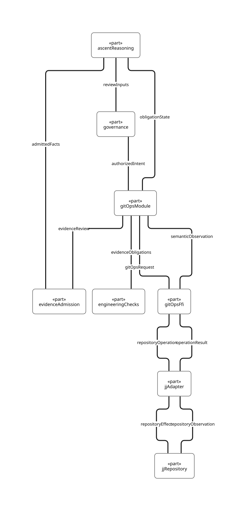
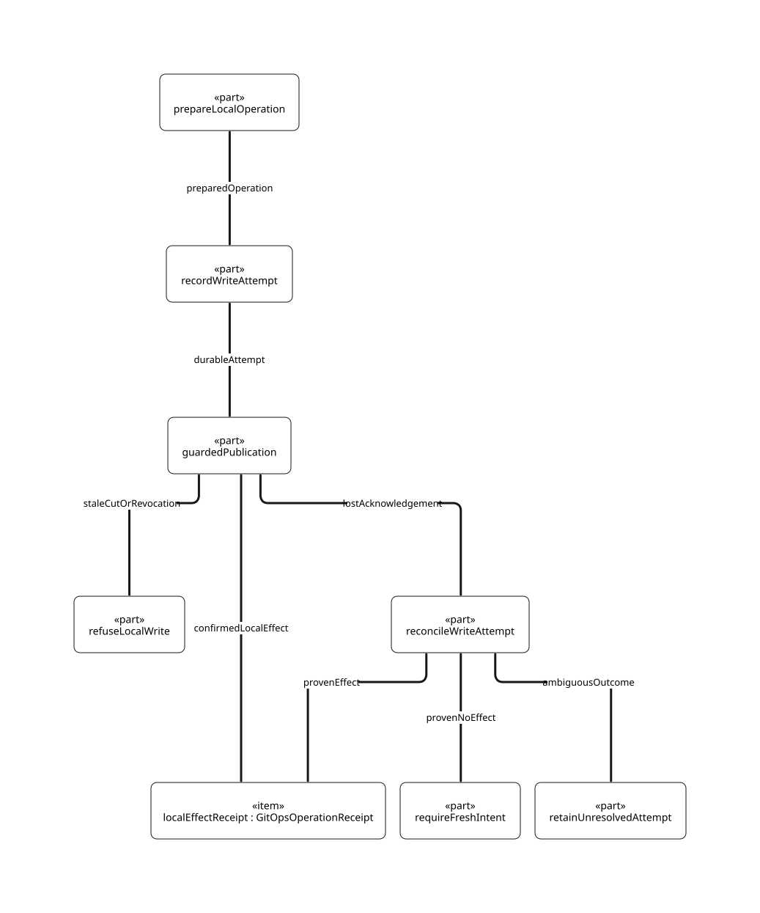

# SPDX-FileCopyrightText: 2026 tao3k team and Contributors
# SPDX-License-Identifier: Apache-2.0 AND LGPL-2.1-or-later

#+title: AITIA GitOps lifecycle and FFI boundary

The  is a view of
[[file:aitia-commit.sysml][the SysML v2 system model]]. It isolates the GitOps capability inside the
SDLC. The AITIA self-application Case is one evidence-driven local commit in
the =lambda-aitia= Git project.

* Responsibility and state

| Owner | State and decisions | Boundary |
|-------+---------------------+----------|
| Yuanxu =modules/gitops= in Scheme | Project declaration, selected operation semantics, identity of the subject, required evidence and review conditions | Declares repository requests against a typed POO port. Receives observations and projects them into the lifecycle. |
| Rust =aitia-jj= | Open repository/workspace, JJ operation view, exact source cut and attributable mutation outcome | Implements the GitOps port through FFI. Reads or changes the repository under the operation's stated authority. |
| Rust engineering Runtime | Owns the execution of a request, cancellation and resource lifetime | Dispatches repository operations and engineering checks. Keeps request and result custody. |
| ORG Contract and ASCENT | ORG admits source-bound observations. ASCENT derives support, conflict, stale evidence and open obligations. | Supplies relations to GitOps and Governance. |
| Governance | Current decision and bounded grants | Determines authority for each repository effect and any publication. |

The SDLC owns Staging, Release and Backport. GitOps supplies repository
operations and evidence to those processes. Developing can produce several
competing GitOps intents against the same cut.

* FFI exchange

The Scheme Module declares the port and the repository operation intent.
The Rust implementation supplies the port. The Rust host can invoke the
Scheme Module to obtain a request, execute the request after the Scheme
call returns, and deliver the result in a subsequent Scheme call. This
keeps one call owner and avoids a Rust-to-Scheme callback while Scheme
is waiting on the Rust operation. Scheme consumers use the same typed
port and do not depend on the representation of a JJ handle.

A request identifies the operation kind, project/workspace, request ID,
expected operation and relevant source cut. A mutation also identifies
the exact intent, effect scope and current Governance grant. Read-only
operations need no mutation grant. The FFI passes values and typed
outcomes. Repository handles, synchronization and process resources
remain with Rust. Scheme can derive a new decision after receiving the
outcome.

| Operation | Preconditions | Result and follow-up |
|-----------+---------------+----------------------|
| Observe recorded cut | Identified Project and workspace | Pinned operation, change, commit, tree and ordered parents. Read configuration and model inputs from this cut. |
| Capture working changes | Explicit snapshot intent and applicable authority | New recorded cut. Review affected obligations against that cut. |
| Evaluate evidence | Cut and configured NASA SDLC obligations | Run checks on captured inputs. ORG binds actual observations. ASCENT exposes supported, contradictory, stale and open obligations. |
| Finalize locally | Current grant scoped to the exact intent and cut. Adapter can enforce the compare-and-write boundary. | Revalidate and consume the grant at the write boundary. Return resulting operation and commit with an attributable receipt. |
| Reconcile unknown outcome | Interrupted mutation with an identified operation attempt | Inspect JJ history and the intended effect. Record applied, proven unapplied or unresolved. An unresolved effect prevents retry. |
| Publish | Separate intent and authority for the external reference | Publication outcome and its own receipt. |

A stable JJ change ID relates rewrites. It is useful for exploring
history. Exact evidence also binds commit, tree, ordered parents and the
observed operation. If another workspace operation invalidates the
expected cut, the adapter refuses the effect. The Module retains the
historical observations and asks ASCENT which obligations must reopen.

* First FFI slice: recorded cut observation

The first port operation is =ObserveRecordedCut=. Scheme opens an
outstanding request for a registered project/workspace. Its request
identity and owner stay live in the Runtime until resolution. A caller
may constrain the observation to an expected operation. The Runtime
resolves the repository location from the registered project and
workspace. It does not resolve an arbitrary path carried by a Scheme
declaration or an ORG artifact.

Rust dispatches the request to =observe_workspace=. It pins the operation,
reads the recorded workspace and exact tree, and checks whether the
operation changed during observation. The success result carries the
same request identity and the full =CommitCut=. The existing adapter
supplies the repository facts. The new port must bind the project
identity and correlate the response. Scheme accepts the result only
while that exact request remains outstanding and the project and
workspace match. An identical duplicate result is inert. A second,
different result for the same request is an integrity failure.

| Outcome | Scheme interpretation |
|---------+-----------------------|
| Observed | Register the cut. Resolve the recorded manifest and model sources from that revision. |
| Changed operation or expected-operation mismatch | Leave the request without an admitted cut. A fresh observation may be proposed. |
| Invalid request or unknown owner | Refuse before dispatch. |
| Backend failure or cancellation | Close the request as unsuccessful. Preserve diagnostics and leave obligations open. |
| Late, replayed or mismatched result | Refuse it. Earlier history remains attributable to its original request. |

A cut establishes the inputs a later check may use. ORG still requires
an independently observed tool outcome before ASCENT can derive support.
Rust already calls rooted Scheme exports and owns the lifetime of the
linked program. The new exchange can reuse that transport in two calls,
one to obtain the declared request and one to return the typed result.
It does not require a new Scheme evaluator or an in-call callback.

The Rust adapter now shares =read_recorded_file= between manifest reads
and future model consumers. The real JJ fixture reads a model path
containing a space from the recorded tree, ignores its dirty worktree
contents, rejects an escaping path, and refuses the old cut after the
operation advances. This verifies one recorded-file read. Resolving the
complete model closure and passing it through the FFI exchange remain
separate integration work.

* Mapping to the current framework

The slot names in the existing column are published by the Yuanxu
GitOps Scope. The required port operations describe the target
interface and do not add new public slot names yet.

| Concern | Existing entry or implementation | Required integration |
|---------+----------------------------------+----------------------|
| Project declaration | =project-config= and =project-config-json= | Keep these Scheme/POO entrypoints. Bind their effective configuration to the same captured source cut used by checks. |
| Read the recorded cut | Rust =observe_workspace= and =observe_project_manifest= | Expose read-only observation to the Scheme lifecycle through the typed GitOps port. |
| Select review conditions | =evaluate= and the selected AITIA Scenario | Evaluate repository policy separately from granting any write. Bind selected NASA obligations to the effective configuration and cut. |
| Admit and derive check evidence | =admit-commit-observation=, =commit-evidence= and =model-gaps= | Carry independently observed check identity and outcome from Rust. Apply the same Scope operations and retain the original source identities. |
| Capture or finalize | No matching write operation in =aitia-jj= | Establish and test the effect boundary before publishing a write capability. |
| Reconcile and publish | No matching operation in =aitia-jj= | Keep reconciliation read-only. Design publication as a separate authorized effect. |

* Writer and recovery criteria

JJ can record divergent operations from concurrent writers and later
reconcile their views. Its operation log records repository history. For
AITIA the design consequence is that an operation ID supplies the
expected view and recovery evidence. Comparing it before a separate
command does not establish the write fence. See
[[https://docs.jj-vcs.dev/latest/operation-log/#divergent-operations][JJ operation log and divergent operations]].

The writer needs a demonstrated boundary that covers the external
writers allowed by its deployment. Serialization inside one Rust host
covers only that host. A workspace lock must be checked against
repository-wide writers and against the grant's actual consumption
semantics. Until those conditions are demonstrated, the adapter exposes
read-only operations.

** JJ v0.47.1 transaction audit

The library separates =Transaction::write= from
=UnpublishedOperation::publish=. The first can persist an operation and
its view without making it a repository head. The second takes the
operation-heads store lock and updates the heads using the new
operation's parents. The stock call does not compare the current head
set with an expected singleton. The store interface also permits lock
implementations without an actual exclusion guarantee.
[[https://github.com/jj-vcs/jj/blob/v0.47.1/lib/src/transaction.rs][Transaction implementation]]
[[https://github.com/jj-vcs/jj/blob/v0.47.1/lib/src/op_heads_store.rs][Operation-heads contract]]

** Reproduced stale-base publication

A disposable colocated repository with JJ 0.47.1 was used to isolate
the stale-base case. Both descriptions targeted the same commit and
specified the same recorded base operation. The second invocation ran
after the first completed. Both exited successfully. A subsequent
ordinary operation-log read reported concurrent modification and
created a reconciliation operation over two distinct description
operations.

#+begin_src sh
# Run inside a fresh disposable directory with JJ 0.47.1.
export JJ_CONFIG=/dev/null JJ_USER='AITIA experiment' JJ_EMAIL='aitia@example.invalid'
jj git init --colocate
base=$(jj --at-op=@ --ignore-working-copy op log --no-graph --limit 1 -T id)
commit=$(jj --at-op="$base" --ignore-working-copy log --no-graph -r @ -T commit_id)
jj --at-op="$base" --ignore-working-copy describe -r "$commit" -m 'writer A'
jj --at-op="$base" --ignore-working-copy describe -r "$commit" -m 'writer B'
jj op log --no-graph --limit 4 -T 'id.short(12) ++ " " ++ description ++ "\n"'
#+end_src

This witnesses a stale-base acceptance by the stock CLI. It exercises
no Governance protocol. AITIA's negative control must instead show that
a second attempt tied to the old expected operation produces no new
visible operation, before any reconciliation can mask the difference.

The initial write candidate is a managed local repository in which the
adapter can demonstrate control over the admitted writer set. The
candidate prepares a JJ operation, binds its ID to the durable
Governance attempt, then conditionally makes it visible. An
implementation must choose a supported conditional head update under
a verified lock, or enforce exclusive writer ownership for the
repository. Calling the stock publish method while holding a second
unverified lock is insufficient. A workspace update, Git ref export
and remote publication require separate boundaries. Ordinary user
repositories with independent writers retain read-only capability
until the stronger boundary is demonstrated.

| Failure or race | Required classification |
|-----------------+-------------------------|
| Prepared JJ operation exists but head publication was refused | The prepared object alone is insufficient to classify the attempt as applied. Check the authoritative head and attempt state. |
| Expected head differs when entering the guarded publication boundary | Refuse the write. Preserve the prior evidence and reopen affected obligations. |
| Grant withdrawal wins before the publication boundary | Refuse the attempt. |
| Grant consumption is durable but the host crashes before acknowledging the write | Keep the attempt pending until reconciliation can prove applied or unapplied. |
| A resulting operation is reachable and matches the recorded attempt, cut and effect | Report the attributable local effect. Verify any separate workspace or export obligations independently. |

Keep an attempt identity before an authorized effect. A returned
receipt must identify the expected and resulting cuts and the effect
it actually established. If the response is lost, reconcile the attempt
against JJ history and the expected effect. A conflicting operation or
ambiguous ancestry yields an unresolved outcome. Fresh authorization
and a proven unapplied attempt are prerequisites for retry.

** Assurance reservation and durable JJ attempt

The [[file:../../modules/assurance/effect-host.ss][current Assurance Effect Host]] serializes operations on one owner
thread. Its reservation consumes a grant once. Delivery revalidates the
grant and consumes the reservation before invoking the configured
handoff. Its receipt explicitly reports =durable? #f=. These are useful
local authorization semantics. The Host's private grant and reservation
objects are process-local and cannot identify an outstanding effect
after restart.

For a managed JJ writer, keep the same separation between grant,
reservation and observed outcome. A durable attempt must bind the
original intent, grant and policy epoch, expected operation, prepared
operation and attempt identity. Before the handoff it records the
one-shot delivery admission. A currentness check and the decision to
admit delivery need one ordering with revocation. The repository writer
fence separately ensures the expected JJ head is still current when
the effect becomes visible.

| Competing events | Required ordering and observable result |
|------------------+-----------------------------------------|
| Revocation wins before delivery admission | No JJ write. Keep any unused preparation as non-effect history. |
| Delivery admission wins, then revocation arrives | The already-admitted attempt may finish under its writer fence. Revocation prevents new admissions. An unknown result requires reconciliation. |
| Head changes after delivery admission | Refuse publication. The consumed delivery admission cannot be replayed against the new head. |
| Restart observes an admitted attempt with no final receipt | Resolve the original attempt using its recorded prepared operation and authoritative repository state. Never reconstruct a live reservation from the receipt. |
| Reconciliation proves the effect absent | A new attempt requires a current decision and grant. Preserve the earlier attempt as history. |

These are proposed ordering rules. The current in-process Assurance
test covers reservation and handoff semantics. It cannot establish
durable consumption or a fenced JJ publication across a crash.

** Repository, checkout and Git export effects

JJ 0.47.1's CLI transaction completion can update colocated Git refs
before committing the JJ transaction, and can update the working copy
afterwards. Its working-copy mutation path checks the locked workspace
tree against the previously observed tree. These are separate effect
boundaries. A successful JJ operation receipt alone cannot establish
the working-copy tree or exported refs.
[[https://github.com/jj-vcs/jj/blob/v0.47.1/cli/src/cli_util.rs#L2226-L2312][JJ transaction completion]]
[[https://github.com/jj-vcs/jj/blob/v0.47.1/cli/src/cli_util.rs#L1549-L1566][Working-copy mutation check]]

For the first managed-repository writer, scope the local receipt to the
JJ operation and exact finalized revision. Keep working-copy updates,
Git ref synchronization and remote publication outside that effect.
The Scheme Scenario can require a separate receipt for any of them.
Recovery reconciles each requested effect by its own observations.

| Observation after interruption | Recovery disposition |
|--------------------------------+----------------------|
| JJ operation and finalized revision attributable, checkout still at an earlier cut | Retain the local receipt and leave the checkout obligation open. Any checkout repair uses its own expected tree and authority. |
| Git refs moved but the expected JJ operation is absent | Record an unresolved repository effect and the observed ref change. The external ref observation does not prove local finalization. |
| JJ operation attributable and the working copy has independent edits | Retain both the local receipt and the edits. Refuse an implicit repair based on the earlier expected tree. |

** Local write and recovery view

The  distinguishes a prepared operation,
a durable attempt, guarded head publication and reconciliation. The
acceptance controls separate effect identity from transport success.

| Case | Expected outcome | Witness to retain |
|------+------------------+-------------------|
| Fresh grant and expected head under the qualified writer boundary | One local effect | Attempt identity and before/after JJ operations |
| Another writer changes the head first | Refuse publication | Actual competing head and affected obligations |
| Withdrawal precedes grant consumption | Refuse publication | Governance withdrawal and no attributable head effect |
| Crash after preparation, before head publication | Reconcile. Require fresh intent after proving no effect | Prepared operation and authoritative repository observation |
| Crash after publication, before receipt return | Recover the original receipt | Reachable operation with matching attempt, cut and effect |
| Outcome cannot be classified | Retain unresolved attempt and fence retry | Conflicting or unavailable observations |

A successful local receipt establishes only the scoped repository
operation. Follow-up workspace updates and external publication have
their own effects and evidence. The view is a design projection. It
does not execute JJ or demonstrate the writer boundary.

** Executable design witnesses

[[file:../proof/quint/GitOpsWriteRecovery.qnt][GitOpsWriteRecovery.qnt]] exercises the proposed single-attempt
protocol under Quint 0.33.0 through =just check-quint-commit=. Seven
witnesses passed. They cover withdrawal on either side of admission,
changed-head refusal, the deliberately unfenced counterexample, a
crash before publication, recovery after a lost receipt, and an
unresolved attempt when authoritative evidence is unavailable.

A sampled run with seed 34, 512 traces and a 12-step bound found no
violation of =writeRequiresExpectedHead= or =receiptMatchesPublication=.
The unsafe publish transition is excluded from the sampled relation
and remains an explicit counterexample witness. The model assumes an
authoritative effect observation for conclusive reconciliation. It does not model how Rust obtains that observation or
how a durable store and JJ publication enforce the boundary.

[[file:../proof/quint/GitOpsAttemptCompetition.qnt][GitOpsAttemptCompetition.qnt]] adds four witnesses for two prepared
attempts against the same expected head. Either attempt can win with
its own grant. The other is refused after the head changes. The
shared-grant witness checks single consumption independently of head
publication. The unsafe witness publishes both attempts when the head
comparison is removed. These abstract actions assume trusted attempt and
grant identities. Actual grant binding, storage and repository locking
remain implementation obligations.

The [[file:../proof/lean/LambdaAitiaProof/Modules/GitOps.lean][Lean GitOps module]] proves three local laws audited by =just check-proof=.
A successful publication advances to a distinct operation, so a
second adjacent publication cannot use the same expected head. A
consumed grant cannot be admitted again, and a withdrawn grant cannot
be admitted. These laws are axiom-free. The head law assumes that the
second publication observes the first publication's resulting head.
An intervening restoration or a backend that can reuse an expected
head needs a separate freshness argument. The runtime must establish
the publication and admission premises before applying the laws.

* Continuous GitOps observations

GitOps feeds the existing Assurance lifecycle with revisions and
observations. Keep Task dependency, repository ancestry, evidence
dependency and effect authority as separate relations. A stacked PR
can identify repository ordering. Composition evidence and Task
readiness still require their own relations.

The current GitOps decision keeps the existing fail-closed aggregate
and also exposes the original current non-success check objects in
=check-blockers=. The Rust JSON projection carries name and conclusion
as =checkBlockers=. Actual failure, cancellation, pending and skipped
remain distinct facts. Stale and missing checks keep their own paths.
These input values still require independent producer admission.
The selected Yuanxu GitOps Module suite passed all four conclusion
controls. The standalone Scheme transport fixture exhausted its
existing heap limit while opening the GitHub Scenario, including after
Scenario staging. The linked Rust consumer verified the new JSON field
through the staged Scenario and completed the remaining CLI cases in
45.88 seconds using the already compiled test executable and the
120-second execution limit. The earlier combined Cargo build and
execution reached its 120-second deadline during the CLI cases.
The warm result qualifies the projected behavior but does not close
the combined gate or the standalone Scheme fixture.

A future GitHub observer must bind provider repository identity,
issuer, workflow run and attempt, and the actual tested revision.
PR head, synthetic merge commit and merge-group head are distinct
subjects. The current GitOps JSON command builds its check objects
using explicitly supplied check-level repository and revision values.
A check row that omits them inherits the enclosing batch subject.
The command remains a policy evaluation over declared inputs. A provider adapter
must preserve each check's independently observed subject before that
evaluation. In particular, an incoming tested revision must never be
relabelled as the active PR revision during projection. An out-of-order
success can remain historical evidence but cannot supersede the active
subject. If merge queue is enabled, its
required workflow must also report for =merge_group=.
[[https://docs.github.com/en/repositories/configuring-branches-and-merges-in-your-repository/configuring-pull-request-merges/managing-a-merge-queue][GitHub merge queue requirements]]

The first integration remains the AITIA self-application Case.
The Rust host owns actual repository and checker execution. Python
consumes the Maturin bindings. ORG admission, ASCENT and Governance
remain Scheme/POO operations. The current OpenGitOps Profile models
declared conditions. A continuously pulling and reconciling controller
is a separate future integration. No GitHub publication or controller
is needed to qualify the local Case.

* AITIA self-application acceptance

| Witness | Required evidence |
|---------+-------------------|
| Read the current AITIA cut | Configuration and model inputs come from the same recorded revision. Dirty edits remain outside this observation. |
| Evaluate a proposed local commit | The selected NASA Scenario contributes concrete obligations. The real checker outcome reaches ORG with independent Rust execution identity. |
| Rewrite the change before finalization | The old evidence remains reviewable. The affected obligations reopen and the old grant cannot write. |
| Accept a fresh proposal | After evidence and Governance admission, exactly one scoped local mutation produces a resulting JJ operation and receipt. |
| Lose the result around the write boundary | Recovery derives the actual outcome from repository history or preserves an explicit unresolved result. Publication requires a separate decision. |

The existing Rust adapter observes recorded cuts and reads a recorded
project manifest. Scheme validates project configuration and exposes the
ORG admission and ASCENT query in separate entrypoints. The current
linked tests exercise configuration and the read-only boundary. The FFI
port specified here, evidence custody for actual selected check execution,
guarded local writes and crash recovery are design obligations. The managed local writer is a candidate. Its repository ownership,
conditional publication and durable attempt protocol remain unqualified.

** Project path fidelity

The Git and JJ adapters remove the command's terminating newline from
path output and preserve trailing spaces in directory names. The real
JJ 0.47.1 integration suite passed with a nested project whose directory
ends in a space. The same test verifies the exact recorded manifest and
model reads, dirty-file isolation, and refusal after an operation changes.

The Rust adapter exposes the cut identity through read-only accessors.
Recorded-file readers take a cut constructed by the observation
adapter. The serialized fields used by the CLI and Scheme fixture retain
their existing names and do not carry execution authority.

After this change, both real-JJ tests passed. The Scheme consumer
printed its module, harness and final success markers, but the
launcher returned 137 before batch completion. The run establishes
the Rust observation results. The combined consumer check still
requires a normal exit under the same deadline.

Project discovery ignores inherited Git repository redirections.
The rebuilt CLI passed a two-repository check with =GIT_DIR= and
=GIT_WORK_TREE= pointing at the other repository. =aitia init= wrote
its minimal manifest under the requested project and left the other
repository without an =.agents= directory.

Manifest observation captures the workspace and reads the file at the
same recorded operation. A single final current-operation check now
covers both reads, removing one intermediate JJ invocation. Standalone
workspace observation keeps its own final check. Both real JJ tests
passed, including stale-operation refusal.
The real JJ integration suite also passed a controlled race. The
fixture records a competing operation after JJ reads the manifest
bytes and before the adapter checks currentness. The adapter returns
=ChangedOperation= instead of a manifest receipt.

The follow-up combined gate passed all three Rust tests. Its Scheme
consumer reached module execution and the recipe returned 137 before
the harness produced a verdict. This run leaves consumer qualification
open under the existing 60-second Scheme limit.

The ORG evidence adapter requires exactly one successful assertion
result before reading the sole observation headline. The consumer
fixture now also rejects an ORG document without an observation.
All three Rust cases passed in the follow-up. The Scheme recipe
returned 137 before the harness verdict, leaving the new negative
case unqualified in that run.
